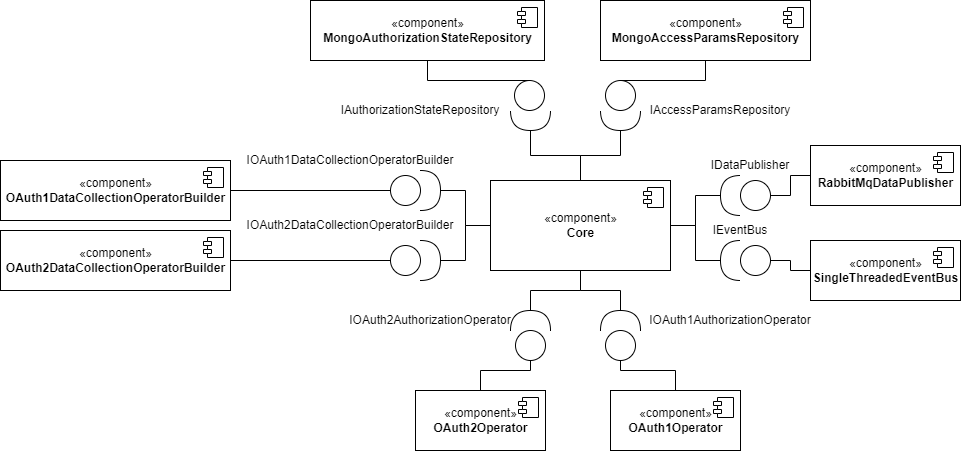
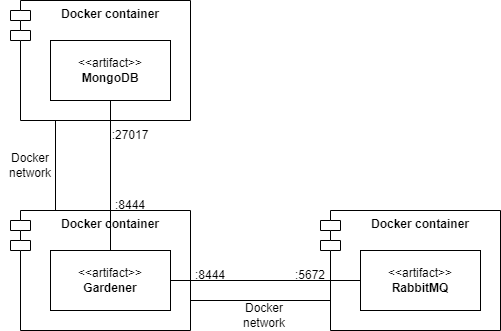

# Gardener CARP Implementation

This package contains an implementation of the Gardener Core customised
to meet [CACHET]("https://www.cachet.dk/") 's requirements. 

## Architecture

The component diagram of the project shows how the required interfaces
of the project are provided:



The _repositories_ are implemented using [PostgreSQL](https://www.postgresql.org/).

The _operators_ are implemented using the [Scribe Java](https://github.com/scribejava/scribejava)
library, which handles the necessary OAuth protocols requirements.

The _EventBus_ uses the [SingleThreadedEventBus](../gardener-core/src/main/kotlin/dk/carp/gardener/authentication/core/infrastructure/eventbus/SingleThreadedEventBus.kt).

The `IDataPublisher` interface is implemented using
[RabbitMQ](https://www.rabbitmq.com/). The data collected from the 
third-party services is transformed into the CARP _data point_ format
and published to the configured RabbitMQ queue.

### Consuming the published messages

A small RabbitMQ client is bundled in `caws-implementation` so you can verify the payloads that
reach the queue. It reuses the same configuration loader as the main service and only needs the RabbitMQ
connection details that are already present in `conf/config-<profile>.json`.

```sh
# From the repository root (uses the `profile` env variable, defaults to `local`)
./gradlew :caws-implementation:runRabbitSubscriber
```

The subscriber connects to `rabbitmq.host`/`rabbitmq.port`, listens on `rabbitmq.queue.name`, and logs every
payload it receives until you stop it with `Ctrl+C`.

> The RabbitMQ integration tests under `gardener-caws-implementation` reuse the locally running broker of the
> carp-webservices stack and are skipped when it is not reachable. Tests run with the `test` profile, so they only
> touch `third-party-queue-test`, never the queue of the `local` stack:
> `./gradlew :caws-implementation:test --tests '*RabbitMqMessagingIntegrationTest*'`.

As every required dependency is resolved the application is functional.
It is designed to run as its own microservice using the [Ktor](https://ktor.io/) server stack and is fully containerized using
[Docker](https://www.docker.com/). PostgreSQL and RabbitMQ are shared with the
carp-webservices stack; the application connects to both over its Docker network. The following deployment diagram displays
how the containers are connected.



## Running the application

There are currently three profiles in the application:
`local`, `test` and `prod`. The respective configuration files are 
located in the resources folder. They declare connection string and secrets
for each environment. The `test` profile is used to run the tests,
`local` profile is for local development and the `prod` is for server 
deployment. To set the desired profile, set the environment variable 
`profile` to the desired value.

The _docker_ folder contains a single Docker Compose file that reads its
profile and database credentials from the repository `.env`. Adjust the
`PROFILE`, `POSTGRES_USER`, and `POSTGRES_PASSWORD` entries as needed before
starting the stack. Compose only starts the application; it reuses the
PostgreSQL and RabbitMQ containers of the carp-webservices stack
(`carp-postgres-<profile>` and `carp-rabbitmq-<profile>`, reached over its
external `carp-<profile>` network), so that stack must be running first.
`POSTGRES_USER`/`POSTGRES_PASSWORD` and `RABBITMQ_USER`/`RABBITMQ_PASSWORD`
are the credentials of those shared services (default `admin`/`admin`).

Following the carp-webservices naming, Gardener publishes to the direct exchange
`third-party-direct-exchange-<profile>`, routed to the queue
`third-party-queue-<profile>` (dead letters go to `<queue>.dlx` / `<queue>.dlq`).
On startup it creates whichever of these are missing and uses existing ones as
they are.

On startup the service prepares PostgreSQL itself, so no manual setup is
needed. It connects to the database named in `postgres.jdbc_url` and creates
it if it does not exist (the user then needs the `CREATEDB` privilege). Its
tables live in their own schema, `postgres.schema` (default `gardener`), so the
database can be shared with other services. Existing schemas, tables and
indexes are used as they are; missing ones are created from
`src/main/resources/db/postgres-schema.sql`.

## Deployment

From the repository root run:

```sh
docker compose -f docker/docker-compose.yml up
```

The active profile is controlled by the `PROFILE` value in `.env`; the default
`local` profile runs the service on host port `8444`, using the shared
PostgreSQL and RabbitMQ of the carp-webservices stack.

## API documentation

The API documentation is done using [Postman](https://www.postman.com/)
and available here with examples.
